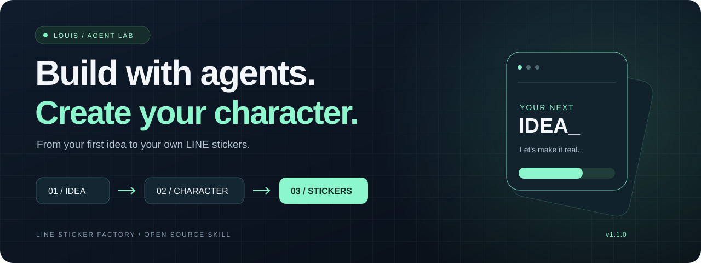

<div align="center">



# 讓 Agent 陪你，把想法變成自己的貼圖。

**沒有 IP 也沒關係。從第一個角色開始，一步一步做出你的 LINE 貼圖。**

[開始安裝](INSTALL-PROMPT.md) · [下載 v1.1.0](https://github.com/thankcoom/line-sticker-factory/releases/download/v1.1.0/line-sticker-factory-v1.1.0.zip) · [加入 Discord](https://discord.gg/cQVP8aHECh) · [追蹤 Louis](https://www.threads.com/@mr.__.l)

`ChatGPT / Codex`　 `繁體中文`　 `MIT Open Source`　 `角色 → 貼圖 → 交付`

</div>

---

## 01 / 你有想法，Agent 陪你往下做

不必先想好整套世界觀，也不必一口氣做完 40 張。
先聊聊你想要的角色，選方向、看候選、不喜歡就改。確定「就是他」之後，再一起安排台詞、表情與動作，先完成第一批 **8 張**。

| 🌱 還沒有 IP | 🎨 已經有角色 | ↗ 接著完成作品 |
| :--- | :--- | :--- |
| 從用途、個性、外型與畫風開始，逐輪討論角色。 | 使用自己的原圖，保留五官、比例與角色特徵。 | 規劃聊天情境、加工圖片、逐張驗收，整理交付。 |

**你的製作路線**

`聊想法` → `選角色方向` → `看圖與修改` → `確認角色` → `規劃 8 張` → `加工與驗收`

完成後取得 **LINE 上傳包、全套總覽、可接續的作品備份**。需要代理操作後台時，再依授權接續上傳。另附表情貼與主題指引；隨附加工器目前只支援靜態貼圖。

## 02 / 複製提示詞，讓 AI 帶你開始

適用能讀取 GitHub 並操作本機的 Codex。以下連結固定在 `v1.1.0`，更新版本請先看發行說明。

```text
請使用技能安裝器，從以下 GitHub 路徑安裝 LINE 貼圖製作技能：
https://github.com/thankcoom/line-sticker-factory/tree/v1.1.0/line-sticker-factory

先讀取儲存庫的 README.md 與「部署與安裝.md」，確認目前環境能否操作本機。
安裝技能及必要 Python 依賴；使用獨立環境，不覆寫既有同名技能或私人角色庫。
請保存實際技能與 Python 路徑，驗證技能可讀取、加工工具可執行，以及八張範例劇本可建立並讀回。
只需要討論或本機製作時，不必先安裝 Ego Lite；需要代理操作 LINE 後台時，再引導我安裝並由我自行登入。
不要向我索取密碼、驗證碼、cookie 或 token，也不要自行改用付費 API。
目前環境不能安裝時，請說明可做的部分與接續步驟，不要宣稱已安裝完成。

準備好後先讓我選：
A. 我沒有 IP，從零設計角色
B. 我已有角色，使用自己的原圖
C. 接續之前的作品
每輪只處理一個主要決定，確認角色後再規劃貼圖。
```

完整提示詞：[安裝與開始使用](INSTALL-PROMPT.md)。安裝與登入可能需要你操作提示視窗；貼上提示詞不保證所有步驟都能無人值守。

## 03 / 嗨，我是 Louis。喜歡讓 Agent 幫我把事情做出來。

2026 年 1 月，我做了一個「貼圖工廠」。當時就想試試看：能不能讓 AI Agent 幫忙，把角色發想、貼圖製作到交付串起來？

這個項目確實有帶來盈利。現在，我把其中的流程與工具整理成這份開源技能包，分享給想做自己角色與 LINE 貼圖的人。這是我的個人經驗，不代表使用後就會有相同收益。

我很喜歡讓 Agent 替我做事，也喜歡探索它能不能替我賺錢。有些想法不試不知道，所以我會持續做、持續分享。如果你手上也有有趣的項目，**很歡迎帶來跟我聊！**

| 跟上我的實作 | 一起交流項目 | 支持我的創作 |
| :--- | :--- | :--- |
| **[Threads ↗](https://www.threads.com/@mr.__.l)** | **[Discord ↗](https://discord.gg/cQVP8aHECh)** | **[LINE 貼圖商店 ↗](https://store.line.me/stickershop/author/5913753/zh-Hant)** |
| Agent、實作過程與項目心得。 | 群內有討論與分享頻道，歡迎聊作品、工具與新點子。 | 找到喜歡的貼圖，就帶回日常聊天裡。 |

商店連結是作品展示入口；商店角色與商品圖片不包含在套件，也不因工具開源而授權重製。

## 04 / 使用前，準備好這幾件事

目前支援範圍是 **ChatGPT／Codex 技能環境**，其他 AI 平台尚未提供相容性保證。

| 你想做的事 | 需要準備 |
|---|---|
| 先討論角色、規劃台詞 | 能讀取套件文件的 AI 對話 |
| 產生角色與貼圖原圖 | 當次對話實際可用的生圖工具及額度；也可自行匯入原圖 |
| 完整本機加工 | 能執行本機工具的 Codex、Python 3.10+、requirements.txt 的固定依賴 |
| 讓代理操作 LINE 後台 | [Ego Lite](https://lite.ego.app/)、可連線的代理環境、自己的 LINE Creators Market 帳號 |
| 使用可編輯文字層 | 自行準備有權使用、涵蓋繁中台詞的字型 |

**一般 ChatGPT 網頁聊天不等於本機安裝環境。** 可以提供文件做對話引導，生圖以當次能力為準；不保證能執行加工器或操作電腦上的 Ego Lite。沒有選項工具時，使用 A/B/C 文字選項。

本套件不附角色素材、帳號、字型或生圖額度，不承諾 LINE 審核通過。

## 05 / 文件與下載

- [下載 v1.1.0 完整分享 ZIP](https://github.com/thankcoom/line-sticker-factory/releases/download/v1.1.0/line-sticker-factory-v1.1.0.zip)
- [查看版本與更新](https://github.com/thankcoom/line-sticker-factory/releases) · [更新紀錄](CHANGELOG.md)
- [部署與安裝手冊](部署與安裝.md)：Mac／Windows 步驟、Ego Lite 設定與部署檢查。
- [完整調用手冊](調用手冊.md)：新角色、既有角色、修改、接續與上傳提示詞。

解壓縮後，`line-sticker-factory/` 是技能資料夾，直接包含 `SKILL.md`；`examples/production-plan-8.json` 是八張劇本範例。不要把整個儲存庫當成單一技能安裝。實際安裝位置依當前宿主與安裝器決定；手動安裝位置見部署手冊。

## 驗證與目前的界限

已完成 macOS 獨立環境的八張範例建立、匯入、加工、預覽，以及未驗收／含字來源改字的拒絕檢查。新人引導另做文件情境驗證。

Windows 實機、新使用者介面的技能發現與互動按鈕、真實生圖、Ego 登入與 LINE 上傳尚未端到端驗證。請先跑部署檢查，再製作正式作品。詳見 [驗證報告](驗證報告.md)。

## 隱私與開源授權

發布內容採白名單整理，角色庫為空，不含私人角色原圖、作品備份、帳號憑證或瀏覽器資料。作者明確授權公開的 Louis 介紹、項目經歷、Threads、Discord 與 LINE 商店連結屬公開介紹內容；私人角色素材與登入資料仍不包含在內。詳見 [隱私與分享檢查](隱私與分享檢查.md)。

工具與文件採 [MIT License](LICENSE)。第三方服務、字型與使用者角色素材各依其原有權利及條款；本專案不代表 LINE 官方。

---

**一起把下一個想法做出來。**

喜歡這個工具，可以給儲存庫一顆 Star、[追蹤 Louis 的 Threads](https://www.threads.com/@mr.__.l)，或[加入 Discord](https://discord.gg/cQVP8aHECh)一起交流。也歡迎[逛逛我的 LINE 貼圖商店](https://store.line.me/stickershop/author/5913753/zh-Hant)支持創作。
