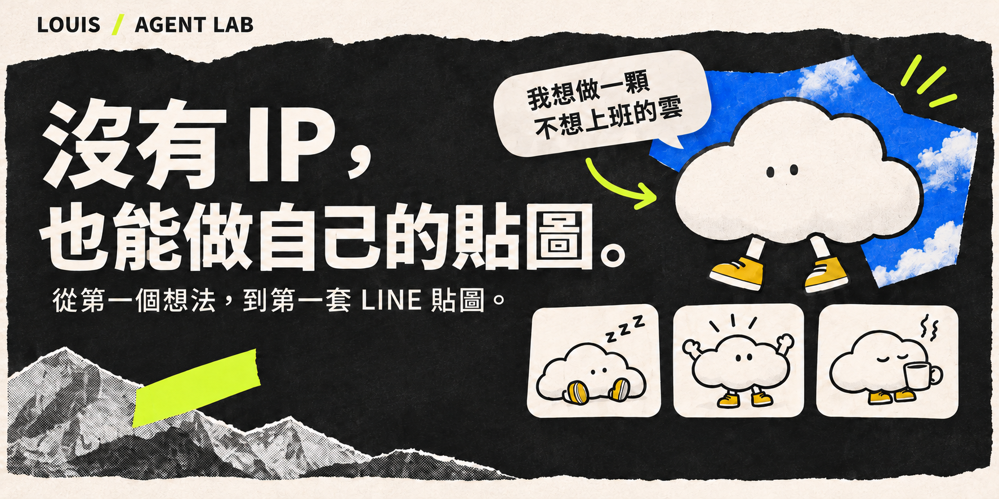
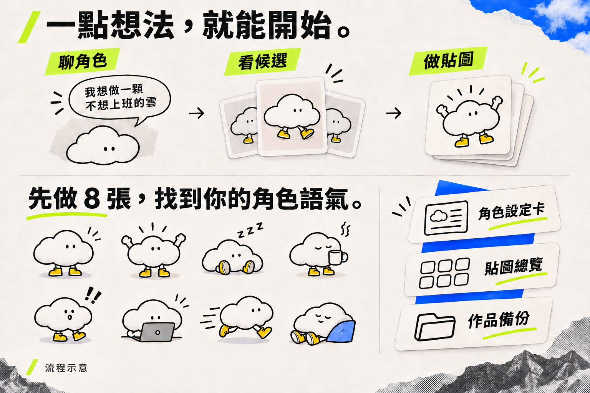

<p align="center">
  
</p>

<p align="center">
  <a href="INSTALL-PROMPT.md"></a>
  <a href="https://github.com/thankcoom/line-sticker-factory/releases/download/v1.2.0/line-sticker-factory-v1.2.0.zip"></a>
  <a href="https://discord.gg/cQVP8aHECh"></a>
</p>

<p align="center"><strong>聊個性 · 挑外型 · 看候選 · 做貼圖</strong><br />沒有角色，就從零開始；有自己的 IP，就讓它走進日常聊天。</p>



## 複製一句，開始製作。

將下面整段複製給能操作本機的 **Codex**，讓 AI 帶你準備環境，再開始討論角色。

```text
請幫我安裝 LINE 貼圖製作技能 v1.2.0：
https://github.com/thankcoom/line-sticker-factory/tree/v1.2.0/line-sticker-factory

先讀取同版本的 README.md 與 INSTALL-PROMPT.md，
確認環境，再依文件安裝與驗證；不要覆寫已有技能或角色庫。
準備好後，先讓我選「從零設計角色」「使用自己的角色」或「接續作品」。
請一步一步引導，確認角色後，再規劃第一批八張貼圖。
如果目前工具無法完成某一步，請說明接續方式。
```

[完整安裝提示詞 ↗](INSTALL-PROMPT.md)　[部署與安裝 ↗](部署與安裝.md)　[使用手冊 ↗](調用手冊.md)

<br />


2026 年 1 月，我做了一個「貼圖工廠」，想試試看能不能讓 Agent 串起角色發想、貼圖製作與交付。這個項目確實帶來過盈利，現在我把流程與工具整理出來，分享給想做自己角色的人。

我喜歡讓 Agent 替我做事，也喜歡探索它能不能替我賺錢。你有正在做的項目、想試的新點子，或剛完成的角色，都歡迎來找我聊！

<p align="center">
  <a href="https://www.threads.com/@mr.__.l"><strong>追蹤 Threads ↗</strong></a>　 ·　
  <a href="https://discord.gg/cQVP8aHECh"><strong>加入 Discord ↗</strong></a>　 ·　
  <a href="https://store.line.me/stickershop/author/5913753/zh-Hant"><strong>逛逛 LINE 貼圖商店 ↗</strong></a>
</p>

<br />

## 開始前，你可能想知道

<details>
<summary><strong>沒有 IP，也能使用嗎？</strong></summary>

可以。先討論角色的用途、個性、外型與畫風，再產生候選、修改及確認。你已有角色時，也可以直接使用自己的原圖。示範雲朵只用於首頁流程展示，正式作品使用你確認的角色。

</details>

<details>
<summary><strong>需要準備哪些工具？</strong></summary>

目前以 ChatGPT／Codex 技能環境為支援範圍。討論與生圖依當次對話能力；完整本機加工需要能執行工具的 Codex、Python 3.10+ 與套件列明的依賴。一般 ChatGPT 網頁對話不保證能直接安裝或操作本機。

要讓 Agent 操作 LINE 後台，電腦需安裝 [Ego Lite](https://lite.ego.app/)，並由你自行登入 LINE 帳號。只有討論角色或本機加工時，可先不設定瀏覽器。後製配字需自行準備合法且涵蓋繁中台詞的字型。

</details>

<details>
<summary><strong>最後會拿到什麼？可以直接上架嗎？</strong></summary>

靜態貼圖完成加工及驗收後，可取得 LINE 圖片上傳包、全套總覽與可還原的作品備份。上傳、送審與販售是不同階段，依你的指示及平台實際狀態進行。另附表情貼與主題製作指引，隨附加工器目前只支援靜態貼圖。

技能不附生圖額度，也不保證審核通過或收益。已驗證範圍及未測項目見[驗證報告](驗證報告.md)。

</details>

<details>
<summary><strong>如何安裝、更新或接續作品？</strong></summary>

下載 [v1.2.0 完整 ZIP](https://github.com/thankcoom/line-sticker-factory/releases/download/v1.2.0/line-sticker-factory-v1.2.0.zip)，解壓後看[先讀我](先讀我.md)。`line-sticker-factory/` 是技能資料夾，範例劇本在 `examples/`。更新前保留既有技能與作品備份，不直接覆寫角色庫。

[安裝提示詞](INSTALL-PROMPT.md) · [部署手冊](部署與安裝.md) · [調用手冊](調用手冊.md) · [版本紀錄](CHANGELOG.md)

</details>

<br />

<a href="https://discord.gg/cQVP8aHECh"></a>

<p align="center">
  <a href="https://github.com/thankcoom/line-sticker-factory/releases">下載與更新</a> ·
  <a href="部署與安裝.md">安裝文件</a> ·
  <a href="LICENSE">MIT License</a> ·
  <a href="隱私與分享檢查.md">隱私說明</a>
</p>
